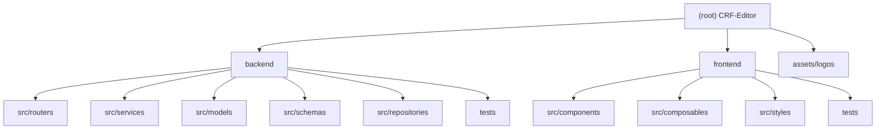

# CRF Editor -- Project AI Context

> Last updated: 2026-10-28
> Keep the root-level document concise; implementation details should go into module-level documents first.

## Project Overview
- The CRF (Case Report Form) editor is used for designing, maintaining, importing, previewing, and exporting clinical research forms.
- Current architecture: FastAPI + SQLAlchemy + SQLite backend, Vue 3 + Vite + Element Plus frontend.
- The backend can host `frontend/dist` when the frontend build artifacts exist; in development mode Vite proxies `/api` to the backend.
- The desktop release entry point is at `backend/app_launcher.py`, used to start the backend locally, open the browser, and keep a system tray.
- User-facing project documentation: `README.md`, `README.en.md`.
- Detailed module descriptions: `backend/.claude/CLAUDE.md`, `frontend/.claude/CLAUDE.md`.

## Module Navigation


## Module Index
| Module | Path | Tech Stack | Responsibilities | Key Entry Points | Tests |
| --- | --- | --- | --- | --- | --- |
| backend | `backend/` | FastAPI, SQLAlchemy, SQLite, Pydantic, PyJWT, passlib, python-docx | API, authentication, admin, project isolation, lightweight migrations, import/export, read-only template field search, reference-aware delete guards, desktop release entry point, preview/export strict parity comparison, Word table-of-contents page number pre-calculation, recycle-bin auto-cleanup background task, weekly AI-assisted source release CLI | `backend/main.py`, `backend/app_launcher.py` | `backend/tests/` |
| frontend | `frontend/` | Vue 3, Vite, Element Plus, sortablejs, vuedraggable | Login, session countdown, project workbench, admin workbench, brief/full editing modes, form designer, import/export, template field search dialog, reference-aware delete gating, theme and preview interaction, Word import wizard dialog, visits form preview dialog | `frontend/src/main.js`, `frontend/src/App.vue`, `frontend/src/components/DesignerWordPreview.vue`, `frontend/src/components/DesignerAcrfAnnotation.vue`, `frontend/src/components/VisitFormPreviewDialog.vue` | `frontend/tests/` |
| assets | `assets/logos/` | Static resources | Logo sample resource notes; runtime uploads are not written to this directory | `assets/logos/README.md` | None |
| deploy | `deploy/` | Shell, systemd | Linux 生产部署：systemd 服务安装/卸载脚本、unit 模板、环境变量样例、Nginx 反代示例 | `deploy/install-service.sh`, `deploy/crf-editor.service.template` | None |

## Core Capabilities
- Management of projects, visits, forms, fields, units, and option dictionaries; the codelist-free single checkbox field (`复选`) has an optional field-definition `checkbox_label` and falls back to the default character `✔` when empty
- Drag ordering plus ordinal quick edit for ordered frontend lists such as dictionaries, options, units, fields, visits, visit-form relations, and designer form lists
- User authentication, admin user management, project isolation, self-service password change for regular users
- Admin recycle bin with estimated-size display, configurable age/size auto-cleanup policy, preview-before-save dry-run, and an in-process background cleanup loop
- Admin workspace with top-level 用户管理 / 机构管理 dual entries; org presets are maintained in-page (persistent list + right editor, stacked on narrow screens) with immediate Logo thumbnails and built-in click-to-zoom preview
- Brief / full editing modes; in full mode, advanced identifiers such as OID / variable names are maintained uniformly, and both the form designer preview and the visits form preview can switch between eCRF / aCRF annotation views; newly authored / manually edited form / field / codelist / unit / visit OIDs are uppercased automatically at entry and at backend write branches (ASCII only; legacy, imported, snapshot-restored identifiers and option codes keep their original casing; field copies mint uppercase `_COPY`-suffixed OIDs); 赛美斯 projects cap manually edited field OIDs at 8 and form OIDs at 10 characters on save, and the OID inputs enforce the caps at entry time via a conditional maxlength (automatic defaults and untouched existing values remain exempt)
- Template library `.db` import, project `.db` import / full-database merge, Word `.docx` import comparison with screenshot evidence panel, and default-off AI review suggestions that can be accepted per suggestion / per form / globally before import
- Read-only 模板字段查询 (template field search) dialog in complete edit mode: a non-modal draggable window cross-references template-library fields by OID / label / source-form OID (`GET /api/template-fields`, excludes 标签 fields / log rows / soft-deleted projects; four-group ranking field-strong > form-OID-strong > field-fuzzy > form-OID-fuzzy over the shared fuzzy rules; inline read-only multi-line source cells `form OID + form name` with 仅字段库 fallback, never copy targets; click-cell-to-copy elsewhere)
- Reference-aware deletion for dictionaries, units, field definitions, and forms: block single deletes when referenced; batch deletes show blocked references and confirm only unreferenced items in one dialog. Dictionary/unit preflight includes unplaced field-library definitions without changing edit-impact queries.
- Form designer real-time preview, full-screen form-switch dropdown and inline form-property editing (OID / name / paper orientation), field instance quick edit and regular-field copy-as-draft with save-gated persistence (log-row copy remains immediate), no-drift undo/redo, simulated CRF rendering, shared full-mode eCRF / aCRF preview switching with 75%-translucent annotation box backgrounds and full-mode form-OID paper-title metadata (`FormPreviewOid.vue`; actual `form.code`, hidden when absent/brief mode), aCRF vertical annotation dragging/persistence, and column width / row height dragging; the designer's two `word-page` previews (main canvas / fullscreen) now share one `DesignerWordPreview.vue` template, with the aCRF marker layer in `DesignerAcrfAnnotation.vue`; the visits form preview is a self-contained `VisitFormPreviewDialog.vue` whose `VisitsTab.vue` parent only toggles it
- Horizontal-table edit guard with immediate narrow rollback and atomic single/batch-delete undo; legacy multi-block forms may retain or reduce their count, while imports and whole-form/project copies remain unchanged (authoritative contract: cross-stack §15).
- Project copy, project Logo management, Word export, database export, preview/export strict table field parity validation
- AI configuration testing, tiered fuzzy search (exact / substring / subsequence / bounded typo tolerance), Element Plus zh-cn locale, iconized list actions with tooltips, centered table selection checkboxes, session countdown with click-to-renew, theme switching, desktop packaging and release
- Weekly AI-assisted source release automation (default-off): Monday schedule + manual dispatch, net-product-diff detection against the last published stable release, bounded/secret-scanned AI payload with closed-schema minor/patch decision, trusted-code three-part version arithmetic, atomic main+tag push with `Release-Plan-V1` envelope, pending-release recovery, source-only GitHub Release（详见 README「每周 AI 辅助发布」）

## Key Entry Points
- Backend development entry: `backend/main.py` (production 模式下自动关闭 uvicorn 热重载)
- Desktop release entry: `backend/app_launcher.py`
- Production deployment: `deploy/install-service.sh` (systemd 服务安装/卸载), `deploy/crf-editor.service.template`, `deploy/crf-editor.env.example`, `deploy/nginx/crf-editor.conf.example`; 使用说明见 README「生产部署（Linux / systemd）」章节
- Backend configuration: `backend/src/config.py` (reads `config.yaml` from the project root; production prefers `CRF_*` environment variables)
- Backend database: `backend/src/database.py` (SQLite PRAGMA, Session, and lightweight migrations)
- Backend routers: `backend/src/routers/`
- Backend services: `backend/src/services/`
- Backend preview/export comparison: `backend/src/services/word_table_parity.py`, `backend/scripts/compare_word_table_parity.py`
- Backend table-of-contents page number pre-calculation: `backend/src/services/toc_pagination.py` (optional LibreOffice + `pypdf`; failure keeps non-empty fallback page numbers and Word field correction)
- Weekly AI-assisted source release: `.github/workflows/weekly-release.yml` (周日 21:00 UTC / 北京周一 05:00，`WEEKLY_RELEASE_ENABLED` 默认关闭，dry run 可能调用外部 AI 但绝不写远端) + `backend/scripts/weekly_release.py` (`plan` / `bump-versions` / `tree-hash` / `publish`，`RELEASE_AI_*` 环境配置，gitleaks 门禁，原子 main+tag 推送，待恢复状态机)；配置与启用说明见 README「每周 AI 辅助发布」章节；这是 2026-10-08 移除 Actions 后唯一的发布专用例外，不恢复合并 CI/PR 门禁
- Frontend entry: `frontend/src/main.js`
- Frontend application shell: `frontend/src/App.vue` (login recovery, project workbench, admin routing, global refresh, brief/full editing modes, theme and settings)
- Frontend development configuration: `frontend/vite.config.js`

## Common Commands
```bash
cd backend && python main.py
cd frontend && npm run dev
cd frontend && npm run build
cd frontend && npm run lint
cd frontend && npm run format
cd backend && python -m pytest
cd backend && python -m pytest --cov=src --cov=main --cov-report=term-missing:skip-covered   # 覆盖率统计（不设门槛）
cd backend && python -m ruff format .          # format all backend Python files (version in requirements-dev.txt, config in backend/ruff.toml)
cd backend && python -m ruff format --check .  # check: exit 1 = reformat needed; other non-zero = runtime/config error
cd frontend && npm test                    # node --test tests/*.test.js && vitest run
cd frontend && npm run test:component      # 仅运行 vitest 组件挂载测试
cd frontend && node --test tests/*.test.js
git config core.hooksPath .githooks  # 一次性启用本机 pre-commit 门禁（所有 worktree 共享）
sudo bash deploy/install-service.sh          # 安装 systemd 生产服务（后台运行 + 开机自启）
sudo bash deploy/install-service.sh uninstall
```

## Development Conventions
- Backend layering: `routers -> repositories/services -> models/schemas`.
- Put heavy logic in `backend/src/services/`, keeping the interface layer lightweight.
- Data structure evolution is centralized in the lightweight migration logic of `backend/src/database.py`.
- Put complex reusable frontend logic in `frontend/src/composables/`.
- Frontend reuse constraints: APIs go uniformly through `useApi.js`; field rendering goes uniformly through `useCRFRenderer.js`; field display attributes and preview display logic go uniformly through `formFieldPresentation.js`; user-facing fuzzy search ordering goes uniformly through `searchRanking.js`; ordinal jump sorting goes uniformly through `useOrdinalQuickEdit.js` alongside `useSortableTable.js` / `useOrderableList.js`.
- When features, commands, or test entry points change, synchronously update `README.md`, `README.en.md`, the module-level `CLAUDE.md`, and `.claude/index.json`.

- Keep `## Change Log` in this file as a one-line index only; full task narratives go to `.context/history/archives/claudemd-changelog.md`. The module-level `CLAUDE.md` files no longer keep their own Change Log — their narratives live in the same archive, and this file keeps the single-line index. This file must stay under the 40k-char context limit.

## Security and Deployment Constraints
- Production deployment prefers the `CRF_*` environment variables from the root `.env.example`.
- When `CRF_ENV=production`, docs are disabled, `CRF_AUTH_SECRET_KEY` must be provided, and JWT TTL must not exceed 60 minutes.
- The login, password-change, and high-cost import endpoints enable single-node in-memory rate limiting in production; the current implementation is not suitable for multi-instance deployments.
- Project Logos only allow bitmap formats; reading historical SVG/XML Logos will be rejected.
- `template_path` must be located within a whitelisted directory and be a `.db` file.
- On first startup with an empty database in production, the reserved admin account is automatically created or repaired; after going live, an admin account audit and access-surface review must be completed immediately.

## Cross-Stack Contracts

> Contract bodies (rules, constants, fixtures, sync file lists) live only in
> `.trellis/spec/guides/cross-stack-contracts.md`. The lines below are pointers — do not restate details here.

- §1 Column width planning — `backend/src/services/width_planning.py` ↔ `frontend/src/composables/useCRFRenderer.js`; shared fixture `backend/tests/fixtures/planner_cases.json` (generator `frontend/scripts/generatePlannerFixtures.mjs`).
- §2 Two-phase ordering — `backend/src/services/order_service.py` ↔ `frontend/src/composables/useOrderableList.js` / `useSortableTable.js`.
- §3 Authentication token schema (incl. rules 4–5 session-scoped token write-back / 401) — `auth_service.py`, `dependencies.py` ↔ `useApi.js`, `App.vue`, `LoginView.vue`.
- §4 Word import screenshot evidence + temp-resource lifecycle — `routers/import_docx.py`, `docx_screenshot_service.py` ↔ `DocxCompareDialog.vue`, `DocxScreenshotPanel.vue`, `WordImportDialog.vue`.
- §5 Word preview / export strict table-field parity — `word_table_parity.py`, `scripts/compare_word_table_parity.py` ↔ `main.css` (`.wp-form-title`).
- §6 aCRF annotation geometry & persistence — `acrfAnnotationGeometry.js`, `useAcrfAnnotationDrag.js` + designer/visits preview chain ↔ `schemas/form.py`, `export_service.py`, `forms.py`, clone/import services.
- §7 Form paper orientation — `models/form.py` + schema/migration/copy/import/export ↔ `FormDesignerTab.vue`.
- §8 Checkbox field type (`复选`) — model/schema/migration/rendering/imports ↔ `FieldsTab.vue`, `FormDesignerTab.vue`, `useCRFRenderer.js`.
- §9 API base path (subpath deployment) — `vite.config.js`, `apiUrl()` bypass sites (e.g. `/crf/assets/...`, `/crf/api/...`); backend zero-aware; nginx strips the prefix.
- §10 OID / identifier charset + uppercase authoring — `schemas/_common.py`, authoring routes, `field_profile_service.py` ↔ `oidValidation.js`, `fieldDefinitionAutocomplete.js`, the five OID-editing tabs.
- §11 Recycle-bin cleanup policy — `config.py`, `routers/admin.py`, `project_size_service.py`, `recycle_bin_cleanup_service.py`, `background_jobs.py` ↔ `AdminView.vue`, `byteSize.js`.
- §12 Template field search index — `routers/template_fields.py`, `template_field_index_service.py` ↔ `templateFieldSearch.js`, `TemplateFieldSearchDialog.vue`.
- §13 Date/time format options — `dateFormatOptions.js` (single option source) ↔ `database.py`, `field_rendering.py`, `docx_import_service.py`, `useCRFRenderer.js`.
- §14 Reference-aware delete guard — `field_definition_reference_service.py`, `codelists.py`, `units.py` ↔ `referenceDeleteGuard.js`.
- §15 Horizontal-table edit guard and atomic restoration — `inline_table_guard.py`, `field_restore_service.py`, `fields.py` ↔ `formFieldPresentation.js`, `FormDesignerTab.vue`; shared fixture `backend/tests/fixtures/inline_table_block_cases.json`.

## Testing Strategy
- Backend tests use `pytest`, covering authentication, permissions, import/export, ordering, column width planning, WAL, security response headers, project isolation, batch-delete isolation, performance FK indexes, Docx screenshot failure semantics, Word table parity, weekly release logic/Git transactions/workflow wiring (`test_weekly_release*.py`), and other cases.
- The backend suite is hermetic: `backend/tests/conftest.py` redirects the database / upload / screenshot / Word-import temp paths to a per-session temp root before `import main`, and equally isolates config sources (`CONFIG_FILE` → a nonexistent file under the temp root; `_ENV_OVERRIDE_MAP` variables other than the three forced keys are scrubbed; the auth secret is always session-random), so a fresh worktree needs no `config.yaml` or pre-seeded database; `backend/tests/test_test_environment_isolation.py` guards the redirect and both config contracts. Coverage is statistics-only (`pytest-cov` is never added to `pytest.ini` addopts).
- Frontend tests come in two disjoint suites: `tests/*.test.js` run by `node:test` (source-level contracts, with the self-developed lightweight property testing utility `testProperty.js`), and `tests/component/**/*.spec.js` run by vitest + @vue/test-utils + happy-dom (real component mount tests; shared global Element Plus registration / ElMessage spies / auto-unmount live in `tests/component/setup.js`, with a per-test non-decreasing real `Date.now` guard (`testClock.js`, self-tested by `testClock.spec.js`) that prevents host clock rollback from swallowing Vue clicks while preserving explicit fake timers, configured by the standalone `frontend/vitest.config.js` whose `include` keeps the suites from overlapping; any Vue warning fails the test via the two-channel gate in `tests/component/vueWarnGate.js`, self-tested by `vueWarnGate.spec.js`). node:test coverage includes the application shell, admin structure, theme, sidebar, designer column width/row height, field display, session countdown, Docx two-column preview, export status, the designer-split and visits-preview-split parent/child wiring guards, and the retained visits-preview F1 acceptance walk; mount tests currently cover the design-notes dialog, the session timer component wiring, the Word import wizard dialog, the designer's merged `word-page` preview and aCRF annotation marker, the visits form preview dialog, the Saimeisi manual-OID length-limit save surfaces (field library, form create/edit-dialog/inline, persisted-field and draft saves incl. a real candidate-rebind pick), and an Element Plus environment smoke case (el-table / el-select / el-tooltip).
- No browser-level E2E suite was found in this scan; the current regression suite is based on API and source-level tests plus vitest component mount tests (real component rendering under happy-dom, without driving a real browser).

## AI Usage Guide
- When touching authentication, JWT, admin permissions, rate limiting, or regular-user password change, check at least these in sync: `backend/src/routers/auth.py`, `backend/src/routers/admin.py`, `backend/src/services/auth_service.py`, `backend/src/services/user_admin_service.py`, `backend/src/rate_limit.py`, `frontend/src/App.vue`, `frontend/src/components/AdminView.vue`.
- When touching import/export or Word preview, check at least these in sync: `backend/src/routers/import_docx.py`, `backend/src/routers/projects.py`, `backend/src/services/import_service.py`, `backend/src/services/project_import_service.py`, `backend/src/services/export_service.py`, `backend/src/services/word_table_parity.py`, `frontend/src/components/TemplatePreviewDialog.vue`, `frontend/src/components/DocxCompareDialog.vue`, `frontend/src/components/DocxScreenshotPanel.vue`, `frontend/src/components/SimulatedCRFForm.vue`.
- When touching column width / preview changes, you must check and update these in sync: `backend/src/services/width_planning.py`, `frontend/src/composables/useCRFRenderer.js`, `backend/tests/test_width_planning.py`, `frontend/tests/columnWidthPlanning.test.js`.
- When touching project isolation or permission boundaries, check first: `backend/src/dependencies.py`, `backend/src/routers/codelists.py`, `backend/tests/test_isolation.py`, `backend/tests/test_subresource_isolation.py`, `backend/tests/test_permission_guards.py`, and `backend/tests/test_codelist_option_authorization.py`.
- When touching the weekly release automation, check at least these in sync: `backend/scripts/weekly_release.py`, `backend/tests/test_weekly_release.py`, `backend/tests/test_weekly_release_git.py`, `backend/tests/test_weekly_release_workflow.py`, `.github/workflows/weekly-release.yml`, the README「每周 AI 辅助发布」chapter (zh+en), and the release-only exception in `.trellis/spec/guides/git-and-tooling-conventions.md`.

## .context Project Context

> The project uses `.context/` to manage development decision context.

- Coding standards: `.context/prefs/coding-style.md`
- Workflow rules: `.context/prefs/workflow.md`
- Decision history: `.context/history/commits.md`

**Rule**: Always read prefs/ before modifying code, and log decisions according to the rules in workflow.md when making decisions.

## Git Workflow
- **Direct commits to `main` (since 2026-10-08)**: updates are committed directly on `main` — no PR, no CI, and no GitHub Actions (all workflows and the `test_ci_merge_gate.py` contract test were removed 2026-10-08; the repo-root `.gitleaks.toml` was removed the same day, then restored for the local pre-commit gate).
- Commit messages: `<type>(<scope>): 中文描述` — Conventional Commits prefix with a Chinese description (types: feat/fix/refactor/docs/test/chore/perf/ci; identifiers and paths stay ASCII).
- Code changes: implement in a dedicated git worktree + task branch → merge locally into `main` after checks pass → remove the worktree and delete the branch.
- `.trellis/` updates (task archives, journal, spec) go into standalone commits, never mixed with project code commits.
- Sub-agent delegation follows the provider-neutral ownership contract in `.trellis/spec/guides/git-and-tooling-conventions.md` §5; external-CLI collaboration (Codex / Antigravity) remains discontinued.
- Detail: `.trellis/spec/guides/git-and-tooling-conventions.md`.

## Change Log

- `2026-10-28` (task `uppercase-oids`): ASCII-uppercase OID authoring across nine inputs and backend writes; preserve legacy/import/snapshot identity and free-text option codes; uppercase `_COPY` naming and a test-only host-clock rollback guard; 8888 user acceptance passed. Details: `.context/history/archives/claudemd-changelog.md`.

- `2026-10-27` (task `single-table-guard`): Horizontal-table edit guards, narrow rollback and atomic delete restoration; legacy/import compatibility, shared fixtures and regression coverage; 8888 deployment and user acceptance passed. Details: `.context/history/archives/claudemd-changelog.md`.

> **Archived (2026-10-13, task `prompt-context-slimming`).** The former per-task index (67 lines) moved verbatim into `.context/history/archives/claudemd-changelog.md`, section "根 `.claude/CLAUDE.md` Change Log 索引快照" (root history was first archived 2026-10-08; module-level logs folded in 2026-10-13). Read the archive only when you need one task's history; add new entries below as single lines and do not rebuild the timeline.

- `2026-10-13` (task `acrf-readable-preview`): aCRF 标注底色半透明（前端 rgba 变量 + Word 导出 DrawingML `a:alpha 25000`，剥离 alpha 后 XML 与基线字节一致；前后端透明度一致性测试）并在完整编辑模式纸面标题行显示表单 OID（新 `FormPreviewOid.vue` 纯展示组件 + `DesignerWordPreview` 第 7 个 prop `showFormOid`，设计器两实例与访视预览接线，长 OID 由 `overflow-wrap: anywhere` 在可用区内断行）；后端 1212 passed / 87%，前端 vitest 115、node:test 全绿、lint/build/parity 通过。详见 `.context/history/archives/claudemd-changelog.md`。
- `2026-10-16` (task `weekly-ai-release`): 新增每周 AI 辅助源码发布自动化（默认关闭）：`.github/workflows/weekly-release.yml` + `backend/scripts/weekly_release.py`（净产品变更判定、限长密钥扫描 AI 载荷、封闭 schema 决策、可信三段版本算术、Release-Plan-V1 信封、原子 main+tag 推送、待恢复状态机）+ 三个测试文件；README 双语新章节、模块文档与 index.json 同步、tooling spec 发布专用例外；后端 1364 passed / 总覆盖 87%（新模块 89%），前端测试/lint/build 复验通过；同日真实 Actions dry-run 验证通过（三轮线上修复：checkout 完整历史与标签、AI 载荷预算 64→256KiB、httpx 延迟导入），真实 AI 判定 0.4.0 积压为 minor→0.5.0，聚焦套件 166 passed / 模块覆盖 91%；`WEEKLY_RELEASE_ENABLED` 仍默认关闭、未做真实发布。详见 `.context/history/archives/claudemd-changelog.md`。
