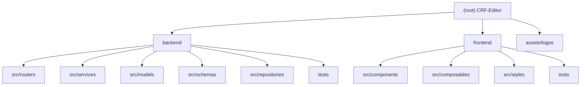

# CRF Editor -- Project AI Context

> Last updated: 2026-10-13
> Keep the root-level document concise; implementation details should go into module-level documents first.

## Project Overview
- The CRF (Case Report Form) editor is used for designing, maintaining, importing, previewing, and exporting clinical research forms.
- Current architecture: FastAPI + SQLAlchemy + SQLite backend, Vue 3 + Vite + Element Plus frontend.
- The backend can host `frontend/dist` when the frontend build artifacts exist; in development mode Vite proxies `/api` to the backend.
- The desktop release entry point is at `backend/app_launcher.py`, used to start the backend locally, open the browser, and keep a system tray.
- User-facing project documentation: `README.md`, `README.en.md`.
- Detailed module descriptions: `backend/.claude/CLAUDE.md`, `frontend/.claude/CLAUDE.md`.

## Module Navigation


## Module Index
| Module | Path | Tech Stack | Responsibilities | Key Entry Points | Tests |
| --- | --- | --- | --- | --- | --- |
| backend | `backend/` | FastAPI, SQLAlchemy, SQLite, Pydantic, PyJWT, passlib, python-docx | API, authentication, admin, project isolation, lightweight migrations, import/export, read-only template field search, reference-aware delete guards, desktop release entry point, preview/export strict parity comparison, Word table-of-contents page number pre-calculation, recycle-bin auto-cleanup background task | `backend/main.py`, `backend/app_launcher.py` | `backend/tests/` |
| frontend | `frontend/` | Vue 3, Vite, Element Plus, sortablejs, vuedraggable | Login, session countdown, project workbench, admin workbench, brief/full editing modes, form designer, import/export, template field search dialog, reference-aware delete gating, theme and preview interaction, Word import wizard dialog, visits form preview dialog | `frontend/src/main.js`, `frontend/src/App.vue`, `frontend/src/components/DesignerWordPreview.vue`, `frontend/src/components/DesignerAcrfAnnotation.vue`, `frontend/src/components/VisitFormPreviewDialog.vue` | `frontend/tests/` |
| assets | `assets/logos/` | Static resources | Logo sample resource notes; runtime uploads are not written to this directory | `assets/logos/README.md` | None |
| deploy | `deploy/` | Shell, systemd | Linux 生产部署：systemd 服务安装/卸载脚本、unit 模板、环境变量样例、Nginx 反代示例 | `deploy/install-service.sh`, `deploy/crf-editor.service.template` | None |

## Core Capabilities
- Management of projects, visits, forms, fields, units, and option dictionaries; the codelist-free single checkbox field (`复选`) has an optional field-definition `checkbox_label` and falls back to the default character `✔` when empty
- Drag ordering plus ordinal quick edit for ordered frontend lists such as dictionaries, options, units, fields, visits, visit-form relations, and designer form lists
- User authentication, admin user management, project isolation, self-service password change for regular users
- Admin recycle bin with estimated-size display, configurable age/size auto-cleanup policy, preview-before-save dry-run, and an in-process background cleanup loop
- Admin workspace with top-level 用户管理 / 机构管理 dual entries; org presets are maintained in-page (persistent list + right editor, stacked on narrow screens) with immediate Logo thumbnails and built-in click-to-zoom preview
- Brief / full editing modes; in full mode, advanced identifiers such as OID / variable names are maintained uniformly, and both the form designer preview and the visits form preview can switch between eCRF / aCRF annotation views
- Template library `.db` import, project `.db` import / full-database merge, Word `.docx` import comparison with screenshot evidence panel, and default-off AI review suggestions that can be accepted per suggestion / per form / globally before import
- Read-only 模板字段查询 (template field search) dialog in complete edit mode: a non-modal draggable window cross-references template-library fields by OID / label / source-form OID (`GET /api/template-fields`, excludes 标签 fields / log rows / soft-deleted projects; four-group ranking field-strong > form-OID-strong > field-fuzzy > form-OID-fuzzy over the shared fuzzy rules; inline read-only multi-line source cells `form OID + form name` with 仅字段库 fallback, never copy targets; click-cell-to-copy elsewhere)
- Reference-aware deletion for dictionaries, units, field definitions, and forms: block single deletes when referenced; batch deletes show blocked references and confirm only unreferenced items in one dialog. Dictionary/unit preflight includes unplaced field-library definitions without changing edit-impact queries.
- Form designer real-time preview, full-screen form-switch dropdown and inline form-property editing (OID / name / paper orientation), field instance quick edit and regular-field copy-as-draft with save-gated persistence (log-row copy remains immediate), no-drift undo/redo, simulated CRF rendering, shared full-mode eCRF / aCRF preview switching, aCRF vertical annotation dragging/persistence, and column width / row height dragging; the designer's two `word-page` previews (main canvas / fullscreen) now share one `DesignerWordPreview.vue` template, with the aCRF marker layer in `DesignerAcrfAnnotation.vue`; the visits form preview is a self-contained `VisitFormPreviewDialog.vue` whose `VisitsTab.vue` parent only toggles it
- Project copy, project Logo management, Word export, database export, preview/export strict table field parity validation
- AI configuration testing, tiered fuzzy search (exact / substring / subsequence / bounded typo tolerance), Element Plus zh-cn locale, iconized list actions with tooltips, centered table selection checkboxes, session countdown with click-to-renew, theme switching, desktop packaging and release

## Key Entry Points
- Backend development entry: `backend/main.py` (production 模式下自动关闭 uvicorn 热重载)
- Desktop release entry: `backend/app_launcher.py`
- Production deployment: `deploy/install-service.sh` (systemd 服务安装/卸载), `deploy/crf-editor.service.template`, `deploy/crf-editor.env.example`, `deploy/nginx/crf-editor.conf.example`; 使用说明见 README「生产部署（Linux / systemd）」章节
- Backend configuration: `backend/src/config.py` (reads `config.yaml` from the project root; production prefers `CRF_*` environment variables)
- Backend database: `backend/src/database.py` (SQLite PRAGMA, Session, and lightweight migrations)
- Backend routers: `backend/src/routers/`
- Backend services: `backend/src/services/`
- Backend preview/export comparison: `backend/src/services/word_table_parity.py`, `backend/scripts/compare_word_table_parity.py`
- Backend table-of-contents page number pre-calculation: `backend/src/services/toc_pagination.py` (optional LibreOffice + `pypdf`; failure keeps non-empty fallback page numbers and Word field correction)
- Frontend entry: `frontend/src/main.js`
- Frontend application shell: `frontend/src/App.vue` (login recovery, project workbench, admin routing, global refresh, brief/full editing modes, theme and settings)
- Frontend development configuration: `frontend/vite.config.js`

## Common Commands
```bash
cd backend && python main.py
cd frontend && npm run dev
cd frontend && npm run build
cd frontend && npm run lint
cd frontend && npm run format
cd backend && python -m pytest
cd backend && python -m pytest --cov=src --cov=main --cov-report=term-missing:skip-covered   # 覆盖率统计（不设门槛）
cd backend && python -m ruff format .          # format all backend Python files (version in requirements-dev.txt, config in backend/ruff.toml)
cd backend && python -m ruff format --check .  # check: exit 1 = reformat needed; other non-zero = runtime/config error
cd frontend && npm test                    # node --test tests/*.test.js && vitest run
cd frontend && npm run test:component      # 仅运行 vitest 组件挂载测试
cd frontend && node --test tests/*.test.js
git config core.hooksPath .githooks  # 一次性启用本机 pre-commit 门禁（所有 worktree 共享）
sudo bash deploy/install-service.sh          # 安装 systemd 生产服务（后台运行 + 开机自启）
sudo bash deploy/install-service.sh uninstall
```

## Development Conventions
- Backend layering: `routers -> repositories/services -> models/schemas`.
- Put heavy logic in `backend/src/services/`, keeping the interface layer lightweight.
- Data structure evolution is centralized in the lightweight migration logic of `backend/src/database.py`.
- Put complex reusable frontend logic in `frontend/src/composables/`.
- Frontend reuse constraints: APIs go uniformly through `useApi.js`; field rendering goes uniformly through `useCRFRenderer.js`; field display attributes and preview display logic go uniformly through `formFieldPresentation.js`; user-facing fuzzy search ordering goes uniformly through `searchRanking.js`; ordinal jump sorting goes uniformly through `useOrdinalQuickEdit.js` alongside `useSortableTable.js` / `useOrderableList.js`.
- When features, commands, or test entry points change, synchronously update `README.md`, `README.en.md`, the module-level `CLAUDE.md`, and `.claude/index.json`.

- Keep `## Change Log` in this file as a one-line index only; full task narratives go to `.context/history/archives/claudemd-changelog.md`. The module-level `CLAUDE.md` files no longer keep their own Change Log — their narratives live in the same archive, and this file keeps the single-line index. This file must stay under the 40k-char context limit.

## Security and Deployment Constraints
- Production deployment prefers the `CRF_*` environment variables from the root `.env.example`.
- When `CRF_ENV=production`, docs are disabled, `CRF_AUTH_SECRET_KEY` must be provided, and JWT TTL must not exceed 60 minutes.
- The login, password-change, and high-cost import endpoints enable single-node in-memory rate limiting in production; the current implementation is not suitable for multi-instance deployments.
- Project Logos only allow bitmap formats; reading historical SVG/XML Logos will be rejected.
- `template_path` must be located within a whitelisted directory and be a `.db` file.
- On first startup with an empty database in production, the reserved admin account is automatically created or repaired; after going live, an admin account audit and access-surface review must be completed immediately.

## Cross-Stack Contracts

> Contract bodies (rules, constants, fixtures, sync file lists) live only in
> `.trellis/spec/guides/cross-stack-contracts.md`. The lines below are pointers — do not restate details here.

- §1 Column width planning — `backend/src/services/width_planning.py` ↔ `frontend/src/composables/useCRFRenderer.js`; shared fixture `backend/tests/fixtures/planner_cases.json` (generator `frontend/scripts/generatePlannerFixtures.mjs`).
- §2 Two-phase ordering — `backend/src/services/order_service.py` ↔ `frontend/src/composables/useOrderableList.js` / `useSortableTable.js`.
- §3 Authentication token schema (incl. rules 4–5 session-scoped token write-back / 401) — `auth_service.py`, `dependencies.py` ↔ `useApi.js`, `App.vue`, `LoginView.vue`.
- §4 Word import screenshot evidence + temp-resource lifecycle — `routers/import_docx.py`, `docx_screenshot_service.py` ↔ `DocxCompareDialog.vue`, `DocxScreenshotPanel.vue`, `WordImportDialog.vue`.
- §5 Word preview / export strict table-field parity — `word_table_parity.py`, `scripts/compare_word_table_parity.py` ↔ `main.css` (`.wp-form-title`).
- §6 aCRF annotation geometry & persistence — `acrfAnnotationGeometry.js`, `useAcrfAnnotationDrag.js` + designer/visits preview chain ↔ `schemas/form.py`, `export_service.py`, `forms.py`, clone/import services.
- §7 Form paper orientation — `models/form.py` + schema/migration/copy/import/export ↔ `FormDesignerTab.vue`.
- §8 Checkbox field type (`复选`) — model/schema/migration/rendering/imports ↔ `FieldsTab.vue`, `FormDesignerTab.vue`, `useCRFRenderer.js`.
- §9 API base path (subpath deployment) — `vite.config.js`, `apiUrl()` bypass sites (e.g. `/crf/assets/...`, `/crf/api/...`); backend zero-aware; nginx strips the prefix.
- §10 OID / identifier charset — `schemas/_common.py` ↔ `oidValidation.js`.
- §11 Recycle-bin cleanup policy — `config.py`, `routers/admin.py`, `project_size_service.py`, `recycle_bin_cleanup_service.py`, `background_jobs.py` ↔ `AdminView.vue`, `byteSize.js`.
- §12 Template field search index — `routers/template_fields.py`, `template_field_index_service.py` ↔ `templateFieldSearch.js`, `TemplateFieldSearchDialog.vue`.
- §13 Date/time format options — `dateFormatOptions.js` (single option source) ↔ `database.py`, `field_rendering.py`, `docx_import_service.py`, `useCRFRenderer.js`.
- §14 Reference-aware delete guard — `field_definition_reference_service.py`, `codelists.py`, `units.py` ↔ `referenceDeleteGuard.js`.

## Testing Strategy
- Backend tests use `pytest`, covering authentication, permissions, import/export, ordering, column width planning, WAL, security response headers, project isolation, batch-delete isolation, performance FK indexes, Docx screenshot failure semantics, Word table parity, and other cases.
- The backend suite is hermetic: `backend/tests/conftest.py` redirects the database / upload / screenshot / Word-import temp paths to a per-session temp root before `import main`, and equally isolates config sources (`CONFIG_FILE` → a nonexistent file under the temp root; `_ENV_OVERRIDE_MAP` variables other than the three forced keys are scrubbed; the auth secret is always session-random), so a fresh worktree needs no `config.yaml` or pre-seeded database; `backend/tests/test_test_environment_isolation.py` guards the redirect and both config contracts. Coverage is statistics-only (`pytest-cov` is never added to `pytest.ini` addopts).
- Frontend tests come in two disjoint suites: `tests/*.test.js` run by `node:test` (source-level contracts, with the self-developed lightweight property testing utility `testProperty.js`), and `tests/component/**/*.spec.js` run by vitest + @vue/test-utils + happy-dom (real component mount tests; shared global Element Plus registration / ElMessage spies / auto-unmount live in `tests/component/setup.js`, configured by the standalone `frontend/vitest.config.js` whose `include` keeps the suites from overlapping; any Vue warning fails the test via the two-channel gate in `tests/component/vueWarnGate.js`, self-tested by `vueWarnGate.spec.js`). node:test coverage includes the application shell, admin structure, theme, sidebar, designer column width/row height, field display, session countdown, Docx two-column preview, export status, the designer-split and visits-preview-split parent/child wiring guards, and the retained visits-preview F1 acceptance walk; mount tests currently cover the design-notes dialog, the session timer component wiring, the Word import wizard dialog, the designer's merged `word-page` preview and aCRF annotation marker, the visits form preview dialog, and an Element Plus environment smoke case (el-table / el-select / el-tooltip).
- No browser-level E2E suite was found in this scan; the current regression suite is based on API and source-level tests plus vitest component mount tests (real component rendering under happy-dom, without driving a real browser).

## AI Usage Guide
- When touching authentication, JWT, admin permissions, rate limiting, or regular-user password change, check at least these in sync: `backend/src/routers/auth.py`, `backend/src/routers/admin.py`, `backend/src/services/auth_service.py`, `backend/src/services/user_admin_service.py`, `backend/src/rate_limit.py`, `frontend/src/App.vue`, `frontend/src/components/AdminView.vue`.
- When touching import/export or Word preview, check at least these in sync: `backend/src/routers/import_docx.py`, `backend/src/routers/projects.py`, `backend/src/services/import_service.py`, `backend/src/services/project_import_service.py`, `backend/src/services/export_service.py`, `backend/src/services/word_table_parity.py`, `frontend/src/components/TemplatePreviewDialog.vue`, `frontend/src/components/DocxCompareDialog.vue`, `frontend/src/components/DocxScreenshotPanel.vue`, `frontend/src/components/SimulatedCRFForm.vue`.
- When touching column width / preview changes, you must check and update these in sync: `backend/src/services/width_planning.py`, `frontend/src/composables/useCRFRenderer.js`, `backend/tests/test_width_planning.py`, `frontend/tests/columnWidthPlanning.test.js`.
- When touching project isolation or permission boundaries, check first: `backend/src/dependencies.py`, `backend/src/routers/codelists.py`, `backend/tests/test_isolation.py`, `backend/tests/test_subresource_isolation.py`, `backend/tests/test_permission_guards.py`, and `backend/tests/test_codelist_option_authorization.py`.

## .context Project Context

> The project uses `.context/` to manage development decision context.

- Coding standards: `.context/prefs/coding-style.md`
- Workflow rules: `.context/prefs/workflow.md`
- Decision history: `.context/history/commits.md`

**Rule**: Always read prefs/ before modifying code, and log decisions according to the rules in workflow.md when making decisions.

## Git Workflow
- **Direct commits to `main` (since 2026-10-08)**: updates are committed directly on `main` — no PR, no CI, and no GitHub Actions (all workflows and the `test_ci_merge_gate.py` contract test were removed 2026-10-08; the repo-root `.gitleaks.toml` was removed the same day, then restored for the local pre-commit gate).
- Commit messages: `<type>(<scope>): 中文描述` — Conventional Commits prefix with a Chinese description (types: feat/fix/refactor/docs/test/chore/perf/ci; identifiers and paths stay ASCII).
- Code changes: implement in a dedicated git worktree + task branch → merge locally into `main` after checks pass → remove the worktree and delete the branch.
- `.trellis/` updates (task archives, journal, spec) go into standalone commits, never mixed with project code commits.
- Sub-agent delegation follows the provider-neutral ownership contract in `.trellis/spec/guides/git-and-tooling-conventions.md` §5; external-CLI collaboration (Codex / Antigravity) remains discontinued.
- Detail: `.trellis/spec/guides/git-and-tooling-conventions.md`.

## Change Log

> Single-line index only. Full entries (root cause / fix / test and live-verification evidence): `.context/history/archives/claudemd-changelog.md` (root index archived 2026-10-08; module-level Change Logs folded in 2026-10-13). Append new entries as single lines only.

- `2026-10-13` (task `docs-sync`): 跨栈契约单一来源收敛：根/后端/前端三份 `CLAUDE.md` 的契约正文改为指向 `.trellis/spec/guides/cross-stack-contracts.md` 的指针（根 §1–§14 逐条锚点；后端 §1/§5/§8 与 §6/§7 同步清单；前端 §1/§3/§5/§8），手写文件计数清除；`.claude/index.json` 补齐 5 个包标记 `__init__.py` 并修复 2 处排序（version 1.4.3）；模块级 Change Log 全文并入归档并改为指针（后端 42 条、前端 59 条，去重 2 条字节相同项）；README 中英测试文件计数改为不计数表述；`cross-stack-contracts.md:62` 交叉引用 §12→§13，`git-and-tooling-conventions.md` 新增变更日志收敛约定。详见 `.context/history/archives/claudemd-changelog.md`。

- `2026-10-13` (rules): 按用户决定删除模型派发框架：项目 spec/prefs/入口文档移除「Haiku 前端审查」等多模型协作条款，改为供应商中立的子代理权约定（Claude 主导、单写入者、审查实际 diff）；同步全局规则树删除 Opus 主导委派 / 模型选择表 / 派发机制（Haiku 前端审查规则移至用户层级管理），在途任务计划去除 Sonnet 派发标注。

- `2026-10-12` (task `visits-preview-split`): 访视预览弹窗外移为 `VisitFormPreviewDialog.vue`（自持权威 FormResponse）+ `useVisitPreviewAnnotation.js`，`VisitsTab.vue` 1545→552 行只剩开关桥；四项 F1 预览缺陷（备注 / 纸张方向 / 表单域注解 / 持久化偏移首开生效）随弹窗外移修复；前端测试 84→87 文件（node:test 973 / vitest 10 文件 102 例）。详见 `.context/history/archives/claudemd-changelog.md`。

- `2026-10-11` (task `designer-split`): 拆分 `FormDesignerTab.vue` 首轮（stateless-first）：两套 `word-page` 预览模板合一为 `DesignerWordPreview.vue`（577 行，父组件渲染两次、`scope` + 模式数据 props + 14 闭包 `previewHandlers` 按引用透传），aCRF 注释标记抽出为 `DesignerAcrfAnnotation.vue`（133 行，9 个规则块 / 12 条选择器的注释 CSS 原样随迁）；父组件 5985 → 4548 行（−24.0%），状态 / resizer 缓存 / 保存 / 撤销 / 会话逻辑与公开 `selectFormById` 全部留在父组件，渲染规则与几何 / 持久化契约零变化。新增 `designerPreviewSplit.test.js`（10）+ 2 个挂载 spec（8 / 18）；合并主线后全量 node:test 964 / vitest 8 文件 76；浏览器 24/24 截图逐字节一致；预览 / 导出 parity 报告与基线字段级一致（0.9240506329，6 项既有失配非本次引入）。详见 `.context/history/archives/claudemd-changelog.md`。
- `2026-10-11` (task `app-word-import-split`): 导入Word向导外移为 `WordImportDialog.vue` + `useWordImport.js`（App 只留入口与可见性），导入后跳转改用事件驱动就绪桥 `useDesignerFormSelection.js`（替代 20×50ms 盲等）；三项声明行为变化（就绪桥、卸载停止轮询、会话重置关闭向导）；node:test 944→954、组件 5/26→6/50、lint 0 errors、App.vue 1913→1341 行。
- `2026-10-10` (task `backend-dedup`): 后端路由 / 迁移 / 排序去重（R1–R6，唯一行为变化为 R1）：共享 `ProjectBatchDeleteRequest`（1..500，空列表 / >500 → 422）、保留管理员自愈移入 `admin_bootstrap_service.py`、`_migrate_add_order_index` 六段回填抽为 `_backfill_null_order`（cx 29→7）、复制改名梯子收敛为 `unique_name.first_free_name`、模板导入错误映射收敛为一个函数、`OrderService` order/sequence 平行方法共用实现、触碰路由内联模型迁入 `schemas/`（新增 `admin.py` / `template_import.py`）；后端 1098→1210 passed / 0 xfailed。详见 `.context/history/archives/claudemd-changelog.md`。
- `2026-10-10` (task `designer-reference-preservation`): 设计器引用字段库字段时保留实例样式（字号哨兵/颜色/加粗/待存默认值），仅在共享定义 9 键归一化后真实变化时写入并确认（`normalizeDefinitionPayload` + 冻结命令参数单一决策源），撤销/重做按正向实际写入回放并保留结构键，候选目标确认阈值降为其他 ≥1 表单；审查轮补齐保存互斥（确认/请求期间锁定编辑器与全部冲突入口）、分叉/草稿结构键继承、fork-redo id 回写、清空日期格式即时归一、换绑后 OID 会话重建；node:test 893 + vitest 11、lint 0 errors、build 通过，覆盖率 100%/98.08%（基线 95.20/97.40），浏览器复测原始缺陷场景通过。详见 `.context/history/archives/claudemd-changelog.md`。
- `2026-10-10` (task `export-layer-cleanup`): Pure export-layer refactor with byte-identical `.docx` output (82 decompressed ZIP entries, 0 diffs at every step): deleted the unreachable `unified_landscape` path and its 4 xfail tests; consolidated option labels through `field_rendering.get_option_labels`, shared structure-row rendering and control dispatch; moved database export to `database_export_service.py` while keeping `ExportError` and `_EXPORT_ERROR_CODES` in `export_service.py`; split `_add_forms_content` by layout (cx 32→7). Final gates: 1071 backend tests passed / 0 xfailed, parity exact 1.0, and no backend source/test references to the removed `unified_landscape` mode. See `.context/history/archives/claudemd-changelog.md`.
- `2026-10-10` (task `reference-delete-guard` 审查跟进): 四个批删接口的 409 引用预检限定本项目 id，消除跨用户「是否被引用」探测；补 56 条回归测试（后端 27 / 前端 29，均经变异验证），恢复 `index.json` 后端命令并修正规格示例；后端 1071→1098、前端 node:test 864→893。详见 `.context/history/archives/claudemd-changelog.md`.
- `2026-10-09` (task `reference-delete-guard`): 四类对象的引用单删拦截与批删分组确认；后端对齐引用查询与 409 守卫并修复字典引用 / 五个选项写接口的 owner 校验，前端只删除确认的未引用项；服务 27、后端测试 65、前端 composables 32、测试 77。详见 `.context/history/archives/claudemd-changelog.md`。

- `2026-10-09` (task `backend-format`): standardized backend Python formatting with `ruff format` only; pinned `ruff==0.16.10`, added format-only `backend/ruff.toml` (py310/120/double; no lint rules), reformatted 134 files (17 legacy CRCRLF files normalized to LF), normalized AST diff 0 and backend suite 1027 passed/4 xfailed matching baseline; registered `fb1ae18` in `.git-blame-ignore-revs` and updated pre-commit Gate 4 to use `ruff format --check --` with separate reformat/runtime-error handling.
- `2026-10-09` (task `legacy-cleanup`): 删除已退役的性能基线管线（后端 `perf.py` / 中间件 / SQL 监听 / 9 文件埋点 / 2 脚本 / 7 perf 测试，前端 `usePerfBaseline.js` / 2 脚本 / 2 perf 测试）、根目录 `shrimp-rules.md` 与无引用死代码（`FieldRepository`、`FieldProfileResult`、main.css 4 组失效选择器、test_export_validation 零引用夹具）；5 个非 perf 设计器辅助数据回归测试迁入 `formDesignerAuxiliaryData.test.js`，被删 perf 测试中两处非 perf 覆盖移植为常规测试（合成 Word 导入解析 → `test_docx_import_synthetic_tables.py`、forms/reorder 端点 → phase0 契约测试）；后端套件 1042→1027 passed（−20 删除的 perf 用例 +5 移植用例），前端 node:test 824→818。
- `2026-10-09` (task `frontend-mount-tests` 合入后复审跟进): 挂载测试 Vue 警告门禁（警告即失败，双通道收集 + 自测用例）与文档更正（flushPromises 假计时器可用、无 `@` 别名、被隐藏的插槽警告、7 处历史测试数字）；前端测试 74→76 文件。
- `2026-10-09` (task `test-config-isolation`): 后端测试会话隔离配置来源：`CONFIG_FILE` 重定向到会话临时根（不存在的文件），`_ENV_OVERRIDE_MAP` 中除强制三项外的 `CRF_*` 变量一律清除，密钥改为每次会话无条件随机；新增两条守卫（路径 / 环境变量，失败只列名不显值），删除按名导入 `CONFIG_FILE` 的陷阱；生产代码零改动（后端 1040→1042）。
- `2026-10-09` (task `frontend-mount-tests`): 引入 vitest + @vue/test-utils + happy-dom 组件挂载测试（`tests/component/*.spec.js`，与 node --test 套件互不相交），npm `test` / `test:component` 脚本与三个种子 spec 文件（9 用例）。
- `2026-10-09` (task `small-defects` 二次复审): 导出失败两分支（生成失败 / 产出校验失败）的裸 `os.unlink` 统一改为 `_remove_temp_file`，临时文件删除撞上 OSError 不再把具体原因吞成通用 500；补 2 条 RED→GREEN 回归测试（后端 1038→1040，export 路由 72%→80%）。
- `2026-10-08` (task `small-defects`): 六个已核实小缺陷修复（每条一提交）：表单复制不再丢失字段样式（项目复制 / 模板导入 / 表单复制三条路径共用按 `FormField` 模型列推导的 `form_field_copy.copy_form_field`）、Word 导出 `ExportError` 原样返回 400 `{detail, code}` 并清理临时文件、迟到响应不再覆盖或清除新会话令牌（`useApi.js` 会话令牌守卫，契约 §3 第 4、5 条）、彻底删除项目先提交数据库再删 Logo 文件、未处理异常 500 记录完整堆栈、回收站清理计划剩余容量只扣一次。
- `2026-10-08` (task `test-isolation`): 后端测试会话隔离真实资源（数据库 / 上传 / 截图 / Word 导入临时路径重定向到会话临时根目录，全新 worktree 零配置直跑），引入 pytest-cov 覆盖率统计（基线 84%）。
- `2026-10-08` (task `pre-commit-gate`): 本机 pre-commit 钩子（gitleaks 暂存区扫描 + 空白/语法/条件格式自检），补上 CI 删除后缺失的提交前检查。
- `2026-10-08` (task `template-field-source-form-oid`): 模板字段查询来源列内联化（表单OID+名称多行只读）+ 表单 OID 搜索（字段强 > 表单强 > 字段模糊 > 表单模糊四组排序）；API `sources[].form_code` 增量字段、历史库缺列只读探测。
- `2026-10-08` (task `docx-temp-ownership`): Word 导入临时文件越权修复：编号改 32 位十六进制并绑定上传者+项目，5 个接口同校验，24 小时自动清理；前端零改动。
- `2026-10-08` (task `docx-screenshot-render-backend`): Word 导入截图渲染后端缺失时平台化报错（Linux 提示安装 LibreOffice）+ 启动自检；README 与部署环境变量样例补齐依赖说明。
- `2026-10-08` (task `remove-github-actions`): 删除 GitHub Actions（`ci.yml` + `gitleaks.yml`）、仓库根 `.gitleaks.toml` 与 `test_ci_merge_gate.py` 契约测试，后端测试 66→65 文件。
- `2026-10-08` (task `spec-workflow-revision`): Git 工作流改版：提交描述改中文；更新直连 `main` 不再走 PR；代码修改走 worktree → 合并 → 清理；`.trellis/` 更新单独提交；多模型协作仅保留 Haiku 作前端审查。
- `2026-09-30` (task `date-time-hour-format`): 日期时间 / 时间字段支持仅到小时格式。
- `2026-09-30` (task `word-underline-limit`): 文本填写线根数上限 80→20（用户定标，≈3.8cm）。
- `2026-09-30` (task `template-field-search`): Read-only template field search.
- `2026-09-30` (task `imported-log-row-label`): 导入的「以下为log行」在设计器左侧字段列表显示为空的修复（纯前端显示回退）。
- `2026-09-29` (task `designer-autocomplete-candidates`): Fixed two fullscreen-designer field-library autocomplete defects dating from `56f77b3`.
- `2026-09-29` (task `auto-merge-after-checks`): PR merges now gated behind CI inside `ci.yml`.
- `2026-09-29` (task `designer-label-oid` 合入后复核跟进): 草稿标签 OID 种子修复。
- `2026-09-29` (task `designer-label-oid`): 标签字段 OID 全面转为系统托管。
- `2026-08-28` (task `designer-copy-field-draft`): Regular-field copy in the form designer now creates a local `__draft__` row without network persistence; Save…
- `2026-08-27` (task `selection-checkbox-center`): Fixed selection checkbox alignment across the codelist/options, unit, field, form, and visit tables.
- `2026-08-17` (task `admin-align-designer-border`): 第二轮实机反馈修复（后端零改动）。
- `2026-08-14` (task `designer-panel-draft-fix`): 设计器三面板单线 + 草稿链接候选定义级修改丢失修复。
- `2026-08-14` (task `visit-flow-workspace`): 访视流程页面化。
- `2026-08-14` (task `toolbar-pane-alignment`): 导入模板入口迁移与共享工具栏契约。
- `2026-08-14` (task `admin-organization-management`): 管理员双入口与机构管理页面化。
- `2026-08-13` (task `global-search-list-actions`): 全局搜索与五类列表交互统一。
- `2026-08-13` (task `designer-notes-chip-capsule`): 设计器顶栏备注 chip 升级为独立胶囊。
- `2026-08-12` (task `designer-notes-chip-contrast`): 设计器顶栏备注 chip 与表单名视觉分隔。
- `2026-08-12` (task `fix-pr67-notes-chip-layout`): 修复 PR#67 合入后用户反馈的「顶栏备注未生效 / 设计界面显示错误」。
- `2026-08-17` (task `admin-property-cards`): 管理端与属性卡体验修复（后端零改动）。
- `2026-08-12` (task `designer-header-notes-linebreak`): 表单设计器顶栏「设计备注」换行显示修复。
- `2026-08-12` (task `admin-recycle-cleanup`): 管理员用户管理页与回收站自动清理联动改造。
- `2026-08-06` (task `codelist-option-oid-free`): 字典选项 OID 放开字符集限制（与标签一致）。
- `2026-08-06` (task `template-import-oid-preserve`): 模板库导入保留表单 / 选项(码表) / 单位的 OID。
- `2026-08-06` (task `frontend-base-path`): 前端支持子路径部署（`/crf/`）。
- `2026-08-05` (task `log-row-readonly-drop-trailing-underscore`): 表单设计器「以下为log行」属性只读化 + 彻底移除选项「后加下划线」。
- `2026-08-04` (task `fix/designer-prop-actions-inline`): 表单设计器字段属性面板的持久化「取消/保存」按钮从卡片底部固定栏回退为滚动区内联位置，与新增字段草稿态呈现一致；log 行仍复用同一组显式保存/取消，移除 `.designer-editor-actions` 固定 footer 样式。
- `2026-08-04` (task `fix/designer-log-row-prop-actions`): 表单设计器「以下为log行」属性面板补回「取消/保存」按钮。
- `2026-08-04` (task `systemd-deployment`): Linux 生产部署优化。
- `2026-07-15` (task `07-15-designer-form-switch-inline-props`): Full-screen form designer gains a form-switch dropdown in the header and an inline form-property editor…
- `2026-07-14` (task `07-14-checkbox-default-check`): Checkbox (`复选`) empty-text fallback changed from the field label to the fixed default character `✔`.
- `2026-07-14` (task `07-14-crf-editor-batch-fixes`): Batch of four independent fixes.
- `2026-07-13` (task `07-13-designer-field-copy`): The form designer now copies persisted field instances directly below their source.
- `2026-07-12` (task `07-12-checkbox-field-type`): Added the codelist-free single checkbox field type (`复选`) across the backend, field library, form designer, previews, and Word export.
- `2026-07-05` (task `07-05-docx-ai-suggestion-accept`): Word 导入预览 now supports default-off AI suggestion acceptance at three levels (per suggestion / per form / all…
- `2026-07-04`: Word 导入截图证据页码匹配修复。
- `2026-06-30`: `annotation_positions` persistence contract gap closed.
- `2026-06-30`: VisitsTab Word preview now shares the persisted `crf_view_mode` with `FormDesignerTab.vue`, renders the same…
- `2026-06-29`: FormDesignerTab preview now adds a complete-mode-only eCRF / aCRF toggle in both the canvas header and…
- `2026-06-25`: VisitsTab right-side visit-form list now uses the same bordered `el-table` + `useSortableTable` mechanism as…
- `2026-06-24`: Ordered-list ordinal quick edit.
- `2026-06-23`: Field library inline codelist editing.
- `2026-06-23`: Frontend search ranking refresh.
